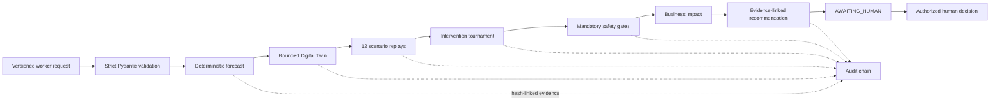

# Building a Human-Governed Reliability Agent: From FastAPI Workflows to a Deployable Domain Worker

Operational AI is easy to demo and difficult to trust. A model can generate a plausible incident summary in seconds, but reliability engineering requires more than plausible language: repeatable calculations, attributable evidence, explicit uncertainty, mandatory safety policy, and a human decision boundary.

This article explains how SentinelOps Nexus was evolved from a set of strong FastAPI workflow endpoints into a single portable reliability-worker contract. The change did not replace the existing deterministic system. It made that system independently invocable, comparable, and auditable.

## The engineering problem

The original workflow already performed useful work:

1. normalize operational telemetry;
2. forecast a safe-capacity crossing;
3. build a bounded Digital Twin;
4. replay twelve deterministic scenarios;
5. score candidate interventions;
6. apply mandatory safety gates;
7. estimate business impact;
8. produce an executive recommendation; and
9. stop at `AWAITING_HUMAN`.

The problem was the external interface. A reviewer had to know which endpoints to call and in which order. That made cross-runtime evaluation harder and obscured an important distinction: the *worker contract* should be portable even when the implementation behind it changes.

The solution was a versioned façade:

```http
POST /api/v1/domain-workers/reliability-analysis
```

```json
{
  "contract_version": "sentinelops.reliability-analysis.v1",
  "correlation_id": "review-2026-001",
  "requested_by": "human-reviewer",
  "name": "Checkout reliability analysis"
}
```

Unknown fields are rejected. The response is also strictly typed and contains the complete decision-support result rather than a free-form narrative.

## Architecture



The backend—not a language model—owns workflow transitions, calculations, candidate eligibility, audit state, and role authorization. Managed-model reasoning can add an explanation, but it cannot change a gate, approve a recommendation, or execute infrastructure changes.

## A portable input/output contract

The request carries a contract version, correlation ID, requestor, display name, and bounded operational controls. The response contains:

- the forecast equation, horizon, confidence label, error bound, assumptions, and evidence IDs;
- all intervention candidates, scores, gates, eligibility, and verdicts;
- business-impact inputs, formula, disclaimer, and evidence IDs;
- the executive recommendation, uncertainty, and contradictory evidence;
- source evidence with content hashes;
- deterministic safety checks;
- audit-chain validity;
- the human-approval boundary; and
- a stable result hash.

The stable hash excludes run IDs and timestamps. Two runs with the same source revision and inputs therefore produce the same analysis hash, while separate workflow IDs preserve audit isolation.

## Evidence before explanation

Each forecast points to concrete evidence records such as `ev-telemetry`, `ev-config`, and `ev-slo`. Evidence carries a source, observation time, bounded payload, summary, and SHA-256 content hash.

The recommendation also lists contradictory evidence. For example, a current error rate can remain below the reactive alert threshold even while the projected capacity trend is unsafe. That contradiction is valuable: it explains why a proactive intervention is being considered before a traditional alert fires.

No hidden chain-of-thought is persisted. The system stores structured findings, inputs, assumptions, decisions, errors, and hashes.

## Safety and human approval

The worker's automated terminal state is always:

```text
AWAITING_HUMAN
```

The response makes the boundary machine-readable:

```json
{
  "required": true,
  "workflow_state": "AWAITING_HUMAN",
  "authorized_roles": ["SENIOR_DEVELOPER"],
  "production_action": "NOT EXECUTED"
}
```

An approval request is not trusted merely because it came from a UI. The backend revalidates the actor token, role, workflow state, candidate eligibility, mandatory gates, rationale, technical verification result, audit integrity, and disabled production boundary.

Even an approval records a governed decision and enables evidence export only. It does not deploy, scale, roll back, reconfigure, or mutate production.

## Failure isolation and graceful degradation

The workflow commits evidence and audit state after each valid stage. If a later stage fails:

- earlier evidence remains inspectable;
- the run remains in the last valid state;
- a `domain_worker.failed` event is added to the hash-linked audit chain;
- the audit payload records only the exception type, not the raw error text;
- structured logs include correlation ID, workflow ID, state, and error type; and
- the API returns a bounded conflict response.

Managed AI is not a single point of failure. If credentials are absent, the deterministic baseline remains authoritative and the integration reports its fallback or blocked state honestly.

## Tests and measured results

The campaign change added tests for:

- strict input validation;
- typed response structure;
- identical result hashes across repeated runs;
- independent workflow IDs;
- deterministic safety checks;
- the human approval boundary;
- production-action prevention;
- audit-chain validity;
- failure-state preservation; and
- error-detail redaction.

Verification completed on 2026-10-12:

| Check | Result |
|---|---|
| Full Python test suite with migration extra | 100 passed |
| Frontend Vitest suite | 37 passed across 5 files |
| Ruff | Passed |
| MyPy on changed Python modules | Passed |
| Frontend TypeScript/Vite production build | Passed |

Three reproducible cases were executed:

| Preset | Safe-capacity crossing | Confidence | Recommended candidate | Estimated exposure (INR) | Audit |
|---|---:|---|---|---:|---|
| Baseline | +30 min | High | OPTIMAL | 14,938,000 | Valid |
| Surge | 0 min | Moderate | OPTIMAL | 147,130,000 | Valid |
| Resilient | +812 min | Moderate | SAFE | 29,626,000 | Valid |

The exposure values are scenario estimates under explicit assumptions. They are not production losses, savings guarantees, or evidence of customer adoption.

## Migrating the orchestration boundary

Once the portable contract was stable, the reliability worker was adapted to the OpenAI Agents SDK without moving authority into a model. The migrated path uses an SDK `Agent`, `Runner`, and strict `function_tool`; the tool still calls the same deterministic workflow and returns its typed response unchanged.

The credential-free evaluator uses an explicitly labelled deterministic routing model to emit one real SDK tool call. Across baseline, surge, and resilient inputs, 30 of 30 paired native/migrated result hashes matched. Every migrated run stopped at `AWAITING_HUMAN`, retained a valid audit chain, and reported `NOT EXECUTED` for production action.

Median local overhead in this small ten-sample-per-case run ranged from 1.850 ms to 8.232 ms. Managed-model task success, latency, token usage, and cost were not measured because no provider credentials were used. Full methodology and raw measurements are in `EVALUATION_RESULTS.md`.

## Reproduce the demonstration

From the repository root:

```bash
python scripts/domain_worker_demo.py --preset baseline
python scripts/domain_worker_demo.py --preset surge
python scripts/domain_worker_demo.py --preset resilient
python -m pytest backend/tests/test_domain_worker.py -q
```

To exercise the API, run the FastAPI application and call the worker endpoint. No managed-model credentials are required for the deterministic worker path.

## Lessons learned

### Portability starts at the contract

Migrating an agent is safer when the behavior contract is stable before the framework changes. The versioned request, response, cases, and result hashes create a test harness for a future migration.

### A high score cannot repair a failed safety gate

The tournament ranks candidates, but eligibility overrides score. This prevents an attractive yet unsafe intervention from being recommended.

### Human-in-the-loop must be enforced, not described

A button labelled “Approve” is not governance. Governance exists when the backend refuses invalid actors, states, gates, evidence, and audit conditions.

### Honest fallback states improve credibility

An unavailable managed model should be reported as unavailable, not quietly represented as a successful cloud invocation.

## Limitations and future work

- The operational model is intentionally bounded and does not control production infrastructure.
- Forecast accuracy depends on the quality and representativeness of input telemetry.
- Business impact is an estimate under displayed assumptions.
- The result hash is intended for reproducibility and comparison; it is not a digital signature.
- The OpenAI Agents SDK adapter is optional, synchronous, and currently covers one specialized worker rather than the entire workforce.
- Managed-model quality, provider latency, token usage, and cost remain unmeasured.
- Competition validation, points, and awards require independent confirmation from the official platform.

## Submission description

> SentinelOps Nexus is a human-governed reliability domain worker with a strict versioned contract. It transforms bounded operational evidence into a deterministic capacity forecast, twelve counterfactual simulations, a safety-gated intervention tournament, explicit uncertainty, and an auditable recommendation. The worker exposes evidence hashes and a stable result hash for cross-runtime comparison, records isolated failures without leaking raw error details, and always stops at `AWAITING_HUMAN`. The full Python and frontend suites pass, and three credential-free demonstration cases are reproducible from the repository.

